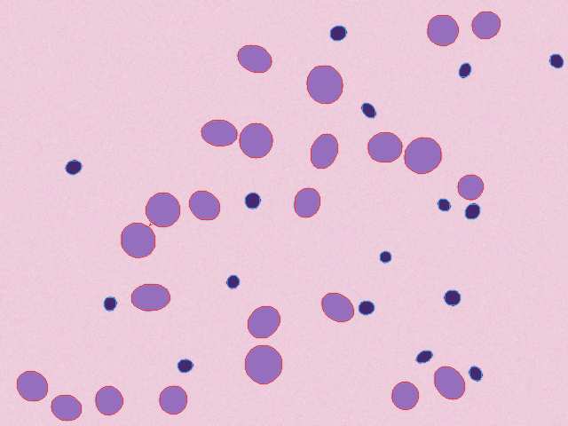

# histocel

A command line tool to train and use models that **outline, classify and count cells** in microscopy images, with your own data.

histocel ships no images, no classes and no pretrained models. You point it at your slides and annotations, declare your classes, and run.

> **Status: pre-alpha.** You can create a project, import annotations (COCO, YOLO-seg, QuPath GeoJSON) and check it for problems, build the training dataset, train a model, analyse whole slides and grade the model on test slides. It has been exercised on synthetic slides only so far; expect rough edges on real data. See the [roadmap](#roadmap).

## Why it exists

Computer vision projects in histology tend to trip in the same places. histocel turns each one into a rule of the tool:

- **Split by slide and by group, never by tile.** Slides from the same animal or patient stay on the same side.
- **A frozen test set** that never picks the model and is only read by evaluation.
- **AI-made ground truth does not grade AI.** Every outline records how it was made; the test set only accepts outlines drawn or reviewed by a person.
- **Tile with overlap and merge on the way back**, so a cell on the border between two tiles is counted once.
- **Report detection, classification, outline quality and counting error separately**, each with a confidence interval.
- **Everything is rebuilt by a command.** The training dataset comes from data plus configuration, identically every time.

## Try it without any data

```bash
git clone https://github.com/ErickGCA/histocel
cd histocel
pip install -e .

histocel synth demo          # a complete project of synthetic slides
histocel import -p demo      # annotations -> canonical format
histocel check -p demo       # problems to fix before training
histocel build -p demo       # tiled training dataset + manifest
```

`synth` creates six synthetic slides in `demo/` (coloured ellipses on a pinkish background), a COCO export with the exact outline of every cell, and a `histocel.yaml`. They look nothing like real tissue: they exist to show the tool working and to test the code against a known answer.

## Example run

The whole pipeline, run on the synthetic slides that ship with the tool. They are coloured ellipses drawn by code, far easier than real tissue, so read this as a demonstration that every stage works and can be reproduced, not as a claim about real slides.

```bash
histocel synth demo --slides 12
histocel import -p demo && histocel build -p demo
histocel train -p demo --epochs 25 --image-size 320 --device cpu
histocel evaluate -p demo
histocel predict demo/raw/images/synthetic-011.png -p demo
```

<p align="center">
  
</p>

Eight slides trained the model (192 tiles, 709 cells), two validated it and two were held out for the final score. Training took about 20 minutes on a laptop CPU. On the two held-out slides (80 cells):

| What was measured | Result |
|---|---|
| Cells found (`detection/f1`) | 1.000 |
| Class correct among cells found (`classification/accuracy`) | 1.000 |
| Outline overlap (`outline/mean_iou`) | 0.914 |
| Counting error per slide, both classes (`count/*/mean_absolute_error`) | 0 cells |

With only two test slides the confidence intervals mean little; `evaluate` prints that warning itself.

## With your own data

```bash
histocel init my-project
```

Put your images in `my-project/raw/images/` and your annotation exports in `my-project/raw/annotations/`, then edit `my-project/histocel.yaml`: list your classes (with the spellings your exports use as aliases) and your annotation sources. Run `histocel import` and `histocel check` from inside the folder.

| Format | `format:` | Notes |
|---|---|---|
| COCO instance segmentation | `coco` | One JSON file. Polygon outlines only; RLE masks are skipped. |
| YOLO segmentation | `yolo-seg` | A folder of `.txt` files. Needs `names: [...]` in the source. |
| QuPath GeoJSON | `qupath` | One `.geojson` per image, named after the image. |

`check` stops you before the mistakes that are expensive to find later: a class name nobody declared, slides of one animal on both sides of the split, a test slide whose outlines no person ever reviewed, an overlap smaller than your largest cell.

## How your data comes in

The histocel repository holds code only. Your data lives in a **project folder** of your own:

```
my-project/
├─ histocel.yaml      # classes, annotation sources, split, tiling
├─ raw/
│  ├─ images/         # your slides, any size
│  └─ annotations/    # exports from your annotation tool
├─ canonical/         # created by histocel: one JSON per slide
├─ datasets/          # created by histocel: disposable
└─ runs/              # created by histocel: models, metrics, records
```

The internal annotation format is described in [docs/canonical-format.md](docs/canonical-format.md).

## The training dataset

`histocel build` writes `datasets/default/` in YOLO segmentation layout: overlapping tiles of the training and validation slides, their labels, a `data.yaml` and a `manifest.json`.

- **Test slides are left out entirely.** They are only read later, as whole slides, by evaluation.
- **Cells on a tile border are cut by real geometry**, and with an overlap larger than your largest cell every cell is whole in at least one tile.
- **A share of the empty tiles is kept** so the model also sees plain background.
- **The manifest holds a hash of the content.** Same annotations and settings, same hash, on any machine. Treat the folder as disposable: never edit it, rebuild it.

## Training

Training needs the optional engine, which pulls in PyTorch:

```bash
pip install "histocel[train] @ git+https://github.com/ErickGCA/histocel"

histocel train --name first-try      # settings come from the `training` section of histocel.yaml
histocel runs                        # list recorded runs
```

Without a GPU, use [notebooks/train_on_colab.ipynb](notebooks/train_on_colab.ipynb): it installs histocel and runs the same commands on a free Colab GPU, with your project folder on Google Drive.

Each run gets a folder under `runs/`:

- `run.json` records the dataset hash, the split, the settings and the histocel and engine versions.
- `model/` holds the weights and a `model.json` with the classes and tile size the model expects, so it cannot be used with the wrong ones.

The scores printed by `train` are measured on validation tiles and only steer training. The final score comes from whole test slides, in the evaluation stage.

## Analysing slides

```bash
histocel predict new-slides/ --out results
```

The slide is cut with the tile size and overlap the model was trained with, each tile is analysed, and detections of the same cell coming from neighbouring tiles are merged so it is counted once. `results/` receives:

- one image per slide with every cell outlined in its class colour;
- `counts.csv`, with the number of cells per class on each slide;
- `canonical/`, the predictions in histocel's annotation format, marked as made by a model and not reviewed.

By default the latest run of the project is used; choose another with `--run` or point to any model folder with `--model`.

## Grading a model

```bash
histocel evaluate
```

`evaluate` runs the model on the slides listed under `split.test`, which nothing in training ever saw, and compares with their annotations. It reports four things separately, because one combined score hides which part failed:

| Question | Metrics |
|---|---|
| Was each cell found, whatever its class? | `detection/precision`, `recall`, `f1` |
| Among the cells found, was the class right? | `classification/accuracy`, `class/<name>/precision`, `recall`, `f1` |
| How well do the outlines overlap? | `outline/mean_iou` |
| How far is the count from the real one? | `count/<name>/mean_absolute_error`, `mean_error` (bias), `r2` |

Every number comes with a 95% confidence interval obtained by resampling whole slides. With few test slides the intervals are wide, and the report says so. Two outlines match when their overlap (IoU) is at least `--iou` (default 0.5); scores obtained with different thresholds do not compare. The report is saved as `evaluation.json` next to the model.

## Roadmap

| Stage | Delivers | Status |
|---|---|---|
| 1 | Pure core, synthetic slides, tests and CI | done |
| 2 | `init`, `import` (COCO, YOLO-seg, QuPath GeoJSON) and `check` | done |
| 3 | `build`: split by slide and group, tiling, manifest | done |
| 4 | `train`: training engine, run records, Colab notebook | done |
| 5 | Whole-slide `predict` and `evaluate` with counting error | done |
| 6 | Box input with assisted outlines (SAM) | to do |
| 7 | User guide and version 0.1 | to do |

Design decisions and their reasons are in [docs/architecture.md](docs/architecture.md).

## Development

```bash
uv sync            # creates the environment with locked versions
uv run pytest      # tests
uv run ruff check . && uv run ruff format --check .
```

## Limits

histocel is a research tool. It is not a medical device and must not be used for diagnosis.

## License

[AGPL-3.0](LICENSE). The planned training engine (YOLO, by Ultralytics) uses this license, and it extends to anyone distributing it alongside. You may use, modify and redistribute freely, keeping the same license.
