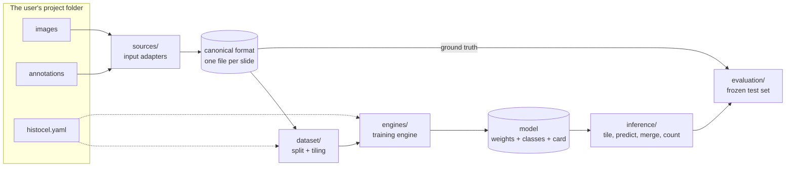

# Architecture

How histocel is organised and why. Each decision names the alternative that was left out.

## Overview

Everything to the right of the canonical format is derived: it can be deleted and rebuilt by a command.

## Layers

| Location | Role | May import |
|---|---|---|
| `core/` | Pure logic: geometry, tiling, taxonomy, splitting, canonical format | standard library and `shapely` |
| `store.py` | Read and write the canonical format on disk | `core` |
| `synthetic/` | Generate fake slides with an exact answer key | `core` |
| `sources/` | Convert annotation tool exports to the canonical format | `core`, `store` |
| `dataset/` | Split, tile and export the training dataset | `core`, `store` |
| `engines/` | Train and predict; the only place that knows the training library | `core` |
| `inference/`, `evaluation/` | Analyse whole slides; measure against ground truth | `core`, `store`, `engines` |
| `cli.py` | Thin shell over the library | everything |

`tests/test_architecture.py` reads the imports of every module and fails when these rules are broken.

## Decisions

**D1. A Python package with a command line.** It runs the same on a laptop, on Colab and on a server. Left out: a collection of scripts (cannot be tested in pieces) and notebooks as the product (hard to version).

**D2. Everything in English.** Code, commands and documentation, so anyone can use and contribute.

**D3. Data lives in a separate project folder.** The repository never contains real data, and the command finds the project through `histocel.yaml`, the way git finds `.git`. Left out: a `data/` folder inside the repository, where one careless `git add` publishes images.

**D4. Canonical format at the centre, pure core, adapters at the edges.** Supporting another annotation tool means writing one file in `sources/`. Left out: YOLO `.txt` as the central format (loses slide position and provenance) and plain single-file COCO (conflicts when two people annotate, no provenance fields).

**D5. Classes are declared by the user.** Official names, aliases and groupings live in `histocel.yaml`; the canonical format always stores the finest class; an unknown name is an error. Left out: accepting any name found in an export, where a typo silently becomes a new class.

**D6. The training dataset is derived.** It is built from canonical annotations plus configuration, with a manifest of hashes; two runs give the same result. Left out: treating the dataset as a file to preserve.

**D7. Split by slide and by group, with a frozen test set.** The test list is written by hand and only evaluation reads it; the rest may go through cross-validation. Left out: sampling by tile, which inflates the score.

**D8. Tiling by pixel size, with overlap, geometric clipping and merging.** If the overlap is larger than the largest cell, every cell appears whole in at least one tile, and `merge_duplicates` makes sure it is counted once. Left out: a fixed grid without overlap.

**D9. Three measures.** Outline quality (mAP), counting error per slide and per class, and the confidence interval of both.

**D10. Boxes as an annotation shortcut.** The product is segmentation only; users who have boxes can turn them into outlines with SAM (an optional extra), and the result is stored as assisted and not reviewed.

**D11. The training engine sits behind an interface.** The first engine is Ultralytics YOLO-seg; only `engines/ultralytics.py` imports it. Candidates for a second engine: Cellpose and StarDist.

**D12. One record per run, and a packaged model.** Each training run records configuration, dataset hash, histocel version and metrics. A model is a folder with weights, class list, tiling parameters and a model card.

**D13. Tests use synthetic slides.** A generator draws cells with known position and class. This gives an exact answer key, no sensitive data and an example that always works. Limit: it proves the plumbing does not leak, not that a model is good on real tissue.

**D14. Environment locked with `uv`.** `pyproject.toml` declares ranges for people who install; `uv.lock` pins exact versions for people who develop; CI tests the oldest and newest supported Python.

**D15. AGPL-3.0 license.** A consequence of using the Ultralytics engine. The interface in D11 leaves room for a permissively licensed engine later.

**D16. The repository ships code only.** No images and no trained weights. Numbered releases on GitHub; PyPI once the interface settles.
