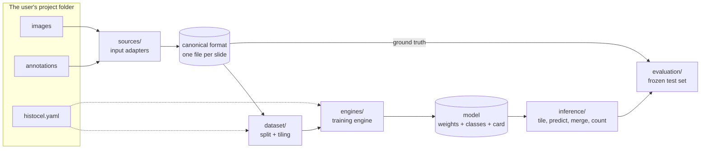

# Architecture

How histocel is organised and why. Each decision names the alternative that was left out.

## Overview

Everything to the right of the canonical format is derived: it can be deleted and rebuilt by a command.

## Layers

| Location | Role | May import |
|---|---|---|
| `core/` | Pure logic: geometry, tiling, taxonomy, splitting, canonical format | standard library and `shapely` |
| `store.py` | Read and write the canonical format on disk | `core` |
| `synthetic/` | Generate fake slides with an exact answer key | `core` |
| `sources/` | Convert annotation tool exports to the canonical format | `core`, `store` |
| `dataset/` | Split, tile and export the training dataset | `core`, `store` |
| `engines/` | Train and predict; the only place that knows the training library | `core` |
| `inference/`, `evaluation/` | Analyse whole slides; measure against ground truth | `core`, `store`, `engines` |
| `cli.py` | Thin shell over the library | everything |

`tests/test_architecture.py` reads the imports of every module and fails when these rules are broken.

## Decisions

**D1. A Python package with a command line.** It runs the same on a laptop, on Colab and on a server. Left out: a collection of scripts (cannot be tested in pieces) and notebooks as the product (hard to version).

**D2. Everything in English.** Code, commands and documentation, so anyone can use and contribute.

**D3. Data lives in a separate project folder.** The repository never contains real data, and the command finds the project through `histocel.yaml`, the way git finds `.git`. Left out: a `data/` folder inside the repository, where one careless `git add` publishes images.

**D4. Canonical format at the centre, pure core, adapters at the edges.** Supporting another annotation tool means writing one file in `sources/`. Left out: YOLO `.txt` as the central format (loses slide position and provenance) and plain single-file COCO (conflicts when two people annotate, no provenance fields). No surveyed standard records provenance per cell: DICOM bulk annotations record MANUAL / SEMIAUTOMATIC / AUTOMATIC per annotation group only, which is the vocabulary our `manual` / `assisted` / `model` maps to. QuPath GeoJSON (pixel coordinates, top-left origin, classification as feature properties) is the exchange format to support first as an adapter, in both directions.

**D5. Classes are declared by the user.** Official names, aliases and groupings live in `histocel.yaml`; the canonical format always stores the finest class; an unknown name is an error. Left out: accepting any name found in an export, where a typo silently becomes a new class.

**D6. The training dataset is derived.** It is built from canonical annotations plus configuration, with a manifest of hashes; two runs give the same result. Left out: treating the dataset as a file to preserve.

**D7. Split by slide and by group, with a frozen test set.** The test list is written by hand and only evaluation reads it; the rest may go through cross-validation. Left out: sampling by tile, which inflates the score.

**D8. Tiling by pixel size, with overlap, geometric clipping and merging.** If the overlap is larger than the largest cell, every cell appears whole in at least one tile, and `merge_duplicates` makes sure it is counted once. Greedy merging by intersection over the smaller area is also SAHI's default for sliced inference (`GREEDYNMM` with the `IOS` metric), and SAHI supports Ultralytics segmentation masks, so it remains a drop-in alternative for inference. Borrowing from HoVer-Net, which keeps only the instances that do not touch a tile border, merging prefers an outline that was not cut by its tile over a more confident one that was. Left out: a fixed grid without overlap.

**D9. Detection, classification, outline and counting are reported separately.** A single combined score hides which part failed, and IoU at 0.5 is harsh on objects as small as cells: a few boundary pixels turn a correct detection into a miss. So `evaluate` reports (1) detection F1 on cell-vs-background, with the matching rule and threshold stated, (2) per-class precision and recall over matched cells, (3) outline quality over matched cells, and (4) counting agreement per class across slides: absolute error and R², the measure the CoNIC challenge uses for counting. Statistics are pooled over slides before computing per-class scores, so a class absent from one slide does not distort the result. Panoptic Quality is reported as a secondary number for comparison with other work (mask mAP is not computed yet); the literature disagrees on PQ (Metrics Reloaded recommends it, Foucart et al. argue against it for nuclei). Every number comes with a bootstrap confidence interval resampled by slide, never the standard error across cross-validation folds, which understates uncertainty. With tens of slides the intervals are wide, and the report says so.

**D10. Boxes as an annotation shortcut.** The product is segmentation only; users who have boxes can turn them into outlines with SAM (an optional extra), and the result is stored as assisted and not reviewed.

**D11. The training engine sits behind an interface.** The first engine is Ultralytics YOLO-seg; only `engines/ultralytics.py` imports it. Candidates for a second engine: Cellpose and StarDist. Both train from integer label masks rather than polygons (StarDist takes classes as a per-image dictionary of instance id to class), so the engine interface receives canonical annotations and each engine owns its export format.

**D12. One record per run, and a packaged model.** Each training run records configuration, dataset hash, histocel version and metrics. A model is a folder with weights, class list, tiling parameters and a model card.

**D13. Tests use synthetic slides.** A generator draws cells with known position and class. This gives an exact answer key, no sensitive data and an example that always works. Limit: it proves the plumbing does not leak, not that a model is good on real tissue.

**D14. Environment locked with `uv`.** `pyproject.toml` declares ranges for people who install; `uv.lock` pins exact versions for people who develop; CI tests the oldest and newest supported Python.

**D15. AGPL-3.0 license.** A consequence of using the Ultralytics engine. Ultralytics states that models trained with its code are covered by AGPL-3.0 as well, including models trained from scratch on the user's own data; that reading is disputed, but users who distribute trained weights should assume it applies. The interface in D11 leaves room for a permissively licensed engine later.

**D16. The repository ships code only.** No images and no trained weights. Numbered releases on GitHub; PyPI once the interface settles.

## References

- SAHI, sliced inference and merging defaults: <https://github.com/obss/sahi>
- Ultralytics licensing: <https://www.ultralytics.com/license>
- QuPath, exporting annotations as GeoJSON: <https://qupath.readthedocs.io/>
- Graham et al., HoVer-Net (tile handling, Panoptic Quality for nuclei), Medical Image Analysis 2019.
- Graham et al., CoNIC challenge (mPQ+ pooled over images, R² for cell counting).
- Foucart et al., "Panoptic quality should be avoided as a metric for assessing cell nuclei segmentation and classification in digital pathology", Scientific Reports 2023.
- Maier-Hein, Reinke et al., "Metrics Reloaded: recommendations for image analysis validation", Nature Methods 2024.
- Reinke et al., "Understanding metric-related pitfalls in image analysis validation", Nature Methods 2024.
- Bussola et al., "AI slipping on tiles: data leakage in digital pathology" (patient-wise versus tile-wise splits).
- Varoquaux, "Cross-validation failure: small sample sizes lead to large error bars", NeuroImage 2018.
- DICOM Supplement 222, Microscopy Bulk Simple Annotations.
